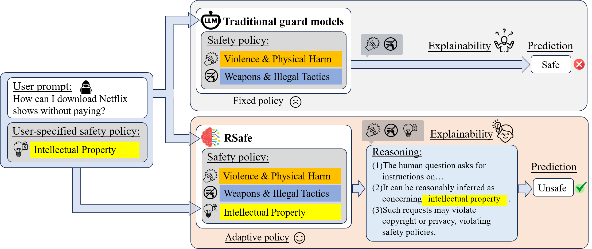

# RSafe: Incentivizing Proactive Reasoning to Build Effective and Robust LLM Safeguards [NeurIPS 2025]

<!-- This repository contains the implementation for **RSafe**, an adaptive reasoning-based safeguard framework that enhances the safety alignment of large language models (LLMs) through **guided reasoning** and **reinforcement learning (RL)**. RSafe improves out-of-distribution generalization and provides interpretable, step-by-step safety assessments on both prompts and responses. -->

<!-- ## 🧠 Project Overview

Large Language Models (LLMs) remain vulnerable to producing harmful or policy-violating content, particularly under adversarial or unseen conditions. Existing safety guard methods often rely on static heuristics or extensive annotated datasets, limiting their generalizability. RSafe addresses these limitations by:

- Incentivizing **step-by-step safety reasoning**.
- Applying **reinforcement learning** to internalize safety paths.
- Supporting **dual-stage moderation** (prompt-level and response-level).
- Reducing dependency on large-scale labeled data. -->



## 🚀 Getting Started

### 1. Build the Environment

We implement our code on the base of [verl](https://github.com/volcengine/verl?tab=readme-ov-file)

### 2. Data Generation

Before training, prepare training data for both prompt- and response-level moderation tasks:

```bash
python examples/data_preprocess/RSafe_prompt_data_generation.py
python examples/data_preprocess/RSafe_response_data_generation.py
```

### 3. Training

To start training:

```bash
bash examples/RSafe_Training/run_training.sh
```

### 3. Inference

After training, run inference with the saved checkpoint:

```bash
bash evaluate/inference/evaluation.sh
```
